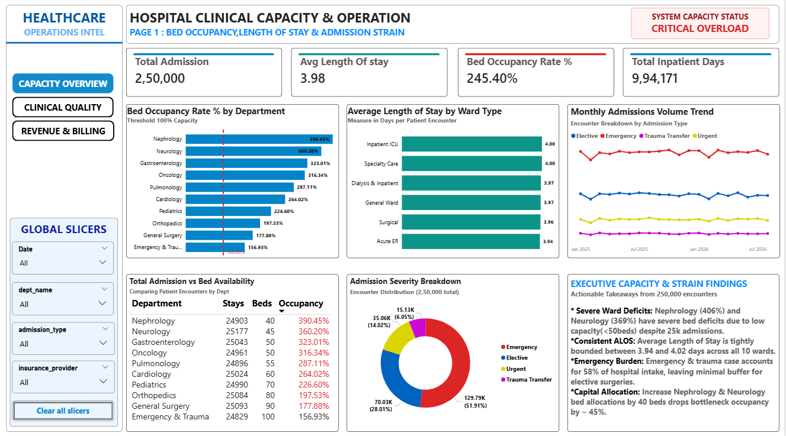
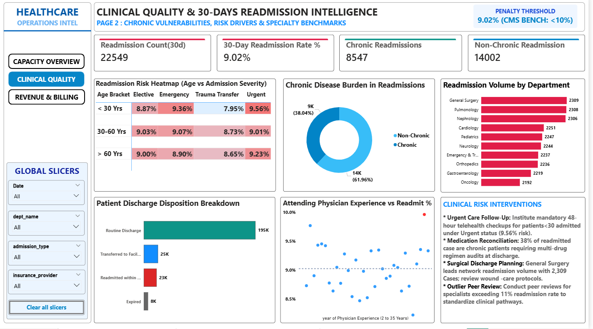
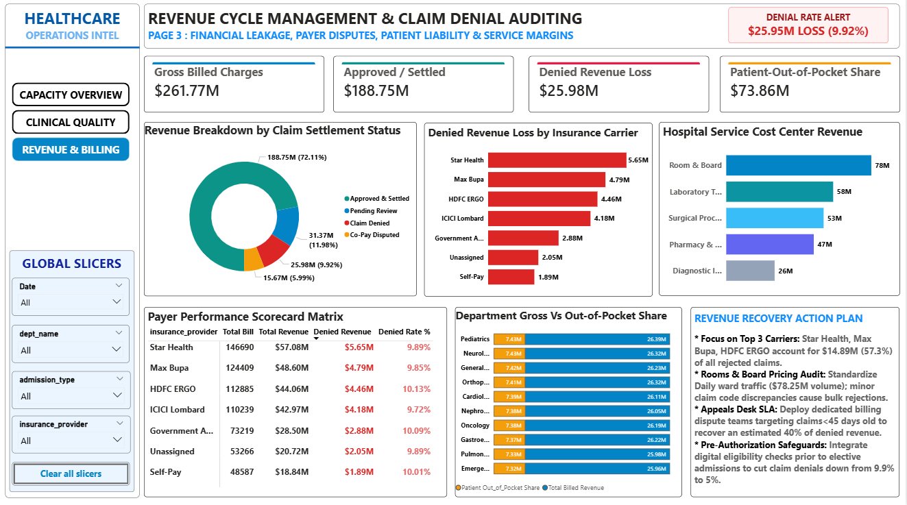

# 🏥 Healthcare Operations & Clinical Resource Intelligence (End-to-End Analytics)


An enterprise-scale healthcare analytics system evaluating **250,000 patient encounters** and **671,915 billing line items** across 10 specialized hospital departments. 

This project isolates clinical capacity bottlenecks, models 30-day readmission risk across patient cohorts, and evaluates financial leakage from denied insurance claims using a custom Python ETL pipeline, relational SQL auditing, and a multi-page Power BI dashboard.

---

## 📌 Executive Summary & Key Metrics

* **Clinical Ward Overload:** Overall network bed occupancy reached **245.40%** across a 608-day operational window, totaling **994,171 inpatient days**. **Nephrology (390.45%)** and **Neurology (360.20%)** operate under severe bed deficits due to restricted bed allotments (<50 beds) despite handling ~25,000 admissions each.
* **Clinical Quality & 30-Day Readmission Risk:** Network 30-day readmission stands at **9.02%** (22,549 readmissions). **Urgent care patients aged <30** exhibit the highest vulnerability at **9.56%**, while chronic disease patients represent **8,547 readmissions (38.04%)**, highlighting the need for structured post-discharge care protocols.
* **Revenue Cycle Management (RCM):** Total gross charges amounted to **$261.77M**, with **$188.75M (72.11%)** successfully settled. However, **$25.98M (9.92%)** was lost to denied claims. Three private insurers (**Star Health, Max Bupa, and HDFC ERGO**) account for **$14.89M (57.3%)** of all denial losses.

---

## 🖥️ Executive Power BI Dashboard Suite

The dashboard is built on a light theme featuring a unified left navigation bar, persistent synchronized global slicers, and structured analytical sections:

### Page 1: Bed Occupancy, Length of Stay & Admission Strain
Tracks hospital-wide bed availability, average length of stay (ALOS), and departmental bed occupancy against safe capacity thresholds.



* **Key KPIs:** Total Admissions (2,50,000) | ALOS (3.98 Days) | Bed Occupancy Rate (245.40%) | Total Inpatient Days (9,94,171)
* **Core Visuals:**
  * **Bed Occupancy Rate % by Department:** Horizontal bar chart comparing ward occupancy rates against a dashed 100% capacity threshold.
  * **Average Length of Stay by Ward Type:** Benchmark evaluation across ICU, Specialty, General, and Surgical units.
  * **Monthly Admissions Volume Trend:** Time-series tracking admissions split by severity (Emergency: 51.91%, Elective: 28.01%, Urgent: 14.02%, Trauma: 6.05%).
  * **Total Admission vs Bed Availability:** Granular department matrix displaying total stays, bed inventories, and individual occupancy rates.

---

### Page 2: Clinical Quality & 30-Days Readmission Intelligence
Identifies patient demographic vulnerabilities, chronic illness burdens, and specialty-specific return volumes to mitigate regulatory penalty exposure.



* **Key KPIs:** Readmission Count (22,549) | 30-Day Readmission Rate (9.02%) | Chronic Readmissions (8,547) | Non-Chronic Readmissions (14,002)
* **Core Visuals:**
  * **Readmission Risk Heatmap Matrix:** Color-scaled cohort grid crossing age brackets (`<30`, `30–60`, `>60`) with admission severity.
  * **Chronic Disease Burden Donut:** Visualizing readmission proportions (Non-Chronic: 61.96% vs. Chronic: 38.04%).
  * **Readmission Volume by Department:** Departmental readmission rankings led by General Surgery (2,309), Pulmonology (2,308), and Nephrology (2,306).
  * **Attending Physician Experience vs. Readmission %:** Scatter plot tracking individual doctor return rates against the 9.02% hospital average to pinpoint clinical outliers.

---

### Page 3: Financial Leakage, Payer Disputes & Service Margins
Audits billing integrity, itemized service charges, insurance claim resolution states, and patient out-of-pocket liabilities.



* **Key KPIs:** Gross Billed Charges ($261.77M) | Approved/Settled ($188.75M) | Denied Revenue Loss ($25.98M) | Patient Out-of-Pocket Share ($73.86M)
* **Core Visuals:**
  * **Claim Settlement Status Donut:** Percentage share of billed revenue across Approved (72.11%), Pending (11.98%), Denied (9.92%), and Disputed (5.99%) states.
  * **Denied Revenue Loss by Insurance Carrier:** Quantifying rejected claim amounts led by Star Health ($5.65M) and Max Bupa ($4.79M).
  * **Hospital Service Cost Center Revenue:** Gross billing breakdown across Room & Board ($78M), Laboratory Testing ($58M), Surgical Procedures ($53M), Pharmacy ($47M), and Imaging ($26M).
  * **Payer Performance Scorecard Matrix:** Multi-column auditing table summarizing total bills, revenue, dollar loss, and denial percentages by payer.

---

## 🏗️ Relational Data Model (Star Schema)

The reporting layer implements an enterprise dimensional model built on 1-to-many single-direction relationships:
```text
dim_departments (1) 
              │ (dept_id)
              ▼
      clean_fact_admissions (1) ──────(admission_id)──────► clean_fact_patient_billing (N)
              ▲              ▲
  (patient_id)│              │(physician_id)
              │              │
    clean_dim_patients (1)  dim_physicians (1)
```
---

### Relational Schema Specifications:
* **`clean_fact_admissions` (Central Fact Table):** 250,000 records containing admission/discharge timestamps, admission categories, validated length of stay, and discharge dispositions.
* **`clean_fact_patient_billing` (Secondary Financial Fact):** 671,915 records containing itemized charge categories, billed amounts, insurance coverage percentages, calculated patient liabilities, and claim resolution states.
* **`clean_dim_patients` (Dimension):** 40,000 records containing standardized patient demographics, age groups, insurance carriers, and chronic condition flags.
* **`dim_departments` (Dimension):** 10 hospital units with assigned ward categories and designated bed capacities.
* **`dim_physicians` (Dimension):** 500 attending specialists mapped to clinical departments with recorded years of clinical experience.

---

## 🧹 Data Cleaning & ETL Pipeline (`HealthCare.py`)

Production data contained logging errors, corrupted timelines, and dirty categorical fields. The Python cleaning script (`python and sql work/HealthCare.py`) resolved these anomalies:

1. **Inverted Timelines & Negative LOS:** Fixed 2,419 records where discharge dates were recorded earlier than admission dates due to telemetry desynchronization. Implemented timestamp swapping to enforce chronological order and recalculated true ceiling Length of Stay ($\ge 1\text{ day}$).
2. **Referential Integrity Audit:** Identified 983 orphan records referencing unmapped patient IDs (`patient_id = 999999`) and flagged them with `is_orphan_patient = 1` to preserve auditability without dropping encounter data.
3. **Transaction Deduplication:** Identified and purged 3,500 duplicate billing logs by partitioning on `billing_id`.
4. **Deterministic Mathematical Imputation:** Rectified 6,604 corrupted patient liability figures using deterministic business logic:
   $$\text{patient\_liability\_amount} = \text{ROUND}(\text{charge\_amount} \times (1 - \text{insurance\_coverage\_pct}), 2)$$
5. **Categorical Harmonization & Null Handling:** Standardized 7 inconsistent gender string variations (`' male '`, `'m '`, `'FEMALE'`, `'f'`) into uniform values (`Male`, `Female`, `Other`). Replaced string-masked nulls (`'UNKNOWN'`, `'null'`, empty strings) in insurance fields with `'Unassigned'`.

---

## 🔍 SQL Auditing & Business Queries (`healthcare queries.sql`)

### 1. Departmental Capacity Strain & Bed Occupancy
```sql
SELECT 
    d.dept_name,
    d.ward_type,
    d.bed_capacity,
    COUNT(a.admission_id) AS total_admissions,
    ROUND(AVG(a.length_of_stay_days), 2) AS avg_length_of_stay,
    SUM(a.length_of_stay_days) AS total_inpatient_days,
    ROUND((SUM(a.length_of_stay_days) * 100.0) / (d.bed_capacity * 608.0), 2) AS bed_occupancy_rate_pct
FROM dim_departments d
LEFT JOIN clean_fact_admissions a ON d.dept_id = a.dept_id
GROUP BY d.dept_id, d.dept_name, d.ward_type, d.bed_capacity
ORDER BY bed_occupancy_rate_pct DESC;
```
### 2. Demographic & Clinical Readmission Vulnerability SQL SELECT 
```sql
      CASE 
        WHEN p.age < 30 THEN '< 30 Yrs'
        WHEN p.age BETWEEN 30 AND 60 THEN '30 - 60 Yrs'
        ELSE '> 60 Yrs'
    END AS age_bracket,
    a.admission_type,
    p.chronic_condition_flag,
    COUNT(a.admission_id) AS total_admissions,
    SUM(CASE WHEN a.discharge_status = 'Readmitted within 30d' THEN 1 ELSE 0 END) AS readmission_count,
    ROUND(SUM(CASE WHEN a.discharge_status = 'Readmitted within 30d' THEN 1.0 ELSE 0.0 END) * 100.0 / COUNT(a.admission_id), 2) AS readmission_rate_pct
FROM clean_fact_admissions a
JOIN clean_dim_patients p ON a.patient_id = p.patient_id
WHERE a.is_orphan_patient = 0
GROUP BY 1, 2, 3
ORDER BY readmission_rate_pct DESC;
```
### 3. Financial Leakage from Denied Insurance ClaimsSQLSELECT 
```sql
    COALESCE(p.insurance_provider, 'Unassigned') AS insurance_provider,
    COUNT(b.billing_id) AS total_billable_events,
    ROUND(SUM(b.charge_amount), 2) AS total_billed_amount,
    SUM(CASE WHEN b.claim_settlement_status = 'Claim Denied' THEN 1 ELSE 0 END) AS denied_claim_count,
    ROUND(SUM(CASE WHEN b.claim_settlement_status = 'Claim Denied' THEN b.charge_amount ELSE 0.0 END), 2) AS total_denied_dollar_loss,
    ROUND(SUM(CASE WHEN b.claim_settlement_status = 'Claim Denied' THEN b.charge_amount ELSE 0.0 END) * 100.0 / SUM(b.charge_amount), 2) AS denial_dollar_rate_pct
FROM clean_fact_patient_billing b
JOIN clean_fact_admissions a ON b.admission_id = a.admission_id
LEFT JOIN clean_dim_patients p ON a.patient_id = p.patient_id
GROUP BY 1
ORDER BY total_denied_dollar_loss DESC;
```
---
## 📂 Repository File StructureBased on the actual project repository setup:   
```text
healthcare/
│
├── clean table/                                  # Cleaned, validated CSV dataset files
│   ├── clean_dim_patients.csv
│   ├── clean_fact_admissions.csv
│   ├── clean_fact_patient_billing.csv
│   ├── dim_departments.csv
│   └── dim_physicians.csv
│
├── python and sql work/                          # Code scripts & analytical queries
│   ├── HealthCare.py                             # Python cleaning & validation pipeline
│   ├── healthcare queries.sql                    # SQL business intelligence queries
│   └── healthcare verfication.sql                # Data verification & audit checks
│
├── Raw Dataset/                                  # Original uncleaned dataset files
│   ├── dim_patients.csv
│   ├── fact_admissions.csv
│   ├── fact_patient_billing.csv
│   ├── dim_departments.csv
│   └── dim_physicians.csv
│
├── screenshot/                                   # Power BI dashboard exports
│   ├── page1_capacity_overview.png               # Page 1: Bed Occupancy & Admission Strain
│   ├── page2_clinical_quality.png                # Page 2: Clinical Quality & Readmission
│   └── page3_revenue_denials.png                 # Page 3: RCM & Denial Analytics
│
├── healthcare.pbix                               # Interactive Power BI report file
└── README.md                                     # Project documentation
```
---
## 🚀 How to Run & Reproduce
### 1.Clone the Repository:
```text
Bash
git clone https://github.com/pwnydvv98-DataAnalytics/healthcare-operations-analytics.git
cd healthcare-operations-analytics
```
### 2.Run the Python Pipeline:
```text 
Bash
cd "python and sql work"
python HealthCare.py
This cleans the raw tables, resolves timeline inversions, recalculates lengths of stay, deduplicates billing records, and outputs sanitized datasets to the clean table/ directory.
```
### 3.Execute SQL Queries:

* **Import the files from `clean table/` into your database (MySQL, PostgreSQL, or SQLite).**

* **Open and execute `healthcare verfication.sql` to confirm zero data quality issues.**

* **Run `healthcare queries.sql` to generate analytical summaries.**

### 4.Explore the Power BI Dashboard:

* **Open `healthcare.pbix` in Power BI Desktop.**

* **Navigate across the 3 report pages using the left sidebar buttons or interact dynamically with the global slicers.**
